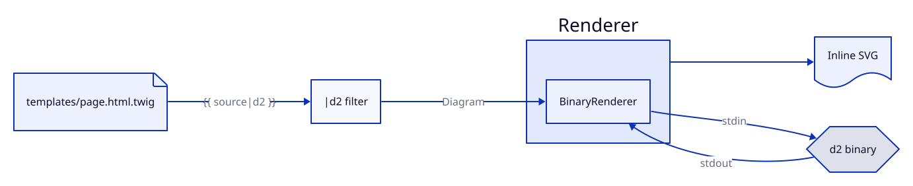

# D2 Symfony

[](https://github.com/aymericcucherousset/d2-symfony/actions/workflows/ci.yml)
[](composer.json)
[](phpstan.neon.dist)
[](LICENSE)

Write [D2](https://d2lang.com) diagrams as text in your Twig templates and get inline SVG, rendered by Symfony.

> [!NOTE]
> Early development (0.3): the API may change between minor versions. See the [roadmap](#roadmap).



<sub>This diagram was rendered by the bundle itself from [`docs/example.d2`](docs/example.d2).</sub>

## Requirements

- PHP 8.2 or later
- Symfony 6.4, 7.4 or 8.x
- Twig 3.21 or later (`symfony/twig-bundle`), for the `|d2` filter and `` tag
- The [`d2` binary](https://d2lang.com/tour/install), downloaded for you by `bin/console d2:download` (Linux, macOS and Windows on amd64 or arm64)

## Installation

1. Install the bundle:

   ```bash
   composer require aymericcucherousset/d2-symfony
   ```

   With [Symfony Flex](https://symfony.com/doc/current/setup/flex.html), the bundle is registered automatically in `config/bundles.php`.

2. Download the `d2` binary:

   ```bash
   bin/console d2:download
   ```

   The command downloads d2 for your platform from the [terrastruct/d2 releases](https://github.com/terrastruct/d2/releases), verifies its SHA-256 checksum and installs it in `var/d2/<version>/`. Run it again with `--force` to reinstall. Add `/var/d2/` to your `.gitignore`, and run the command in your deployment (or Docker build) too.

   The version is pinned (`d2.binary_version`, a version tested with the bundle). Prefer your own installation? [Install d2](https://d2lang.com/tour/install) in your `PATH` or set `d2.binary_path`: the bundle uses, in order, `d2.binary_path`, the downloaded binary, then `d2` from the `PATH`.

### Without Symfony Flex

Register the bundle in `config/bundles.php`:

```php
return [
    // ...
    Aymericcucherousset\D2Symfony\D2SymfonyBundle::class => ['all' => true],
];
```

## Configuration

No configuration is required. Here is the full reference with the default values, to put in `config/packages/d2.yaml` if you need to change something:

```yaml
d2:
    # Name of the d2 executable looked up in the PATH, or path to it.
    # ~ uses the binary installed by d2:download, then "d2" from the PATH.
    binary_path: ~

    # Version installed by bin/console d2:download.
    binary_version: v0.9.0

    # Where bin/console d2:download installs the binary.
    install_dir: '%kernel.project_dir%/var/d2'

    # Maximum rendering time in seconds; ~ disables the limit.
    timeout: 60

    # Options applied to every diagram unless overridden.
    # ~ means "use the d2 default".
    defaults:
        theme: ~      # d2 theme ID, e.g. 200 (dark mauve)
        layout: ~     # layout engine: dagre (d2 default) or elk
        pad: ~        # padding around the diagram, in pixels (d2 default: 100)
        sketch: false # hand-drawn look

    # Cache rendered SVG (set to false to disable).
    cache:
        enabled: true
        pool: cache.d2 # PSR-6 pool service, created automatically

    twig:
        # Render static  tags when templates are compiled; ~ = when kernel.debug is false.
        prerender_static: ~
```

Invalid values (negative padding, unknown layout format, unknown keys…) are rejected when the container is built.

## Usage

### Twig

Pipe D2 source into the `|d2` filter; it outputs the SVG markup, ready to inline in your HTML:

```twig
{{ 'shop -> payment: checkout'|d2 }}
```

Multi-line diagrams read best with a `` block, and options override the configured defaults:

```twig

direction: right
user -> app: HTTPS
app -> db: SQL
db: { shape: cylinder }


<figure>
    {{ architecture|d2({ theme: 200, sketch: true }) }}
</figure>
```

Available options: `theme` (int), `layout` (string), `pad` (int) and `sketch` (bool); `null` resets an option to the d2 default. Twig variables work as usual: `{{ diagram.source|d2 }}`.

The `` tag lets you write the diagram directly in the template, with the same options:

```twig

user -> app: {{ protocol }}

app -> {{ service }}


```

Twig variables and tags work inside the body; their output is **not** HTML-escaped, since it is D2 source (d2 escapes labels in the generated SVG).

### PHP

Autowire the `Renderer` service anywhere in your application:

```php
use Aymericcucherousset\D2Symfony\Core\Diagram;
use Aymericcucherousset\D2Symfony\Core\Renderer;
use Aymericcucherousset\D2Symfony\Core\RenderOptions;
use Symfony\Component\HttpFoundation\Response;

final class DiagramController
{
    public function __construct(private Renderer $renderer)
    {
    }

    public function __invoke(): Response
    {
        $svg = $this->renderer->render(new Diagram(
            'a -> b',
            new RenderOptions(layout: 'elk', sketch: true),
        ));

        return new Response($svg, headers: ['Content-Type' => 'image/svg+xml']);
    }
}
```

### Kroki (without the d2 binary)

Where running binaries is not allowed, `KrokiRenderer` renders diagrams over HTTP with [Kroki](https://kroki.io), the public instance or a self-hosted one. It is not wired by the bundle yet: build it from any Symfony HTTP client.

```php
use Aymericcucherousset\D2Symfony\Core\Diagram;
use Aymericcucherousset\D2Symfony\Core\KrokiRenderer;
use Symfony\Component\HttpClient\HttpClient;

$renderer = new KrokiRenderer(
    HttpClient::create(),
    'https://kroki.example.com', // default: https://kroki.io
    timeout: 10.0,               // seconds, default 60; null uses the HTTP client default
    logger: $logger,             // optional PSR-3 logger
);

$svg = $renderer->render(new Diagram('a -> b'));
```

The `theme`, `layout`, `pad` and `sketch` options are forwarded to Kroki. Options Kroki does not support are ignored, and a warning is logged. HTTP and network errors throw a `RenderException`, and D2 syntax errors reported by Kroki are parsed as with the binary.

> [!NOTE]
> The diagram source is sent to the Kroki server. Use a self-hosted instance for private diagrams.

### Caching

Rendered SVG is cached in the `cache.d2` pool (backed by `cache.app`), so each diagram is rendered by d2 only once. The cache key covers the D2 source, the options and the d2 version: diagrams are rendered again after a d2 upgrade (the version is checked every 5 minutes). To use another backend, point `d2.cache.pool` to any PSR-6 pool, or configure `cache.d2` under `framework.cache.pools`.

Clear it with:

```bash
bin/console cache:pool:clear cache.d2
```

#### Pre-rendering static diagrams

When `kernel.debug` is false (production), `` tags whose body and options are constant are rendered once, when the template is compiled, and the SVG is embedded in the compiled template. Since `bin/console cache:warmup` compiles every template, static diagrams then never call d2 at runtime, even with an empty cache.

A diagram is static when its body contains no Twig expression or tag and its options are a literal hash (``). Diagrams that cannot be rendered at compile time (syntax error, d2 missing on the build machine…) are rendered at runtime as usual.

Pre-rendering is disabled in debug mode, as compiled templates outlive changes to the `d2` configuration there. Force it either way with:

```yaml
d2:
    twig:
        prerender_static: true # or false; ~ (default) = enabled when kernel.debug is false
```

### Errors

Every exception thrown by the bundle implements `Aymericcucherousset\D2Symfony\Core\Exception\D2Exception`:

| Exception | Thrown when |
| --- | --- |
| `RenderException` | d2 rejects the source or rendering fails (timeout, Kroki HTTP error…); `getD2Line()` / `getD2Column()` locate the first D2 error, `getD2Errors()` lists them all, `getD2Error()` returns the raw d2 output |
| `BinaryNotFoundException` | the `d2` binary is missing or not executable (run `bin/console d2:download`) |
| `InvalidArgumentException` | a diagram or an option is invalid (empty source, unknown option…) |

In templates, Twig wraps them in a `Twig\Error\RuntimeError` pointing to the template line. For the `` tag, a D2 syntax error points to the template line of the faulty D2 line, so the Symfony error page highlights it:

```
D2 syntax error at line 2, column 4: maps must be terminated with } in "page.html.twig" at line 14
```

(The mapping is exact for static bodies; Twig expressions printing several lines shift the lines after them.)

## Roadmap

| Milestone | Goal |
| --- | --- |
| [v0.1.0 — Working core](https://github.com/aymericcucherousset/d2-symfony/milestone/1) | Render a D2 diagram to SVG from Twig using a manually installed binary. |
| [v0.2.0 — Caching & Twig ergonomics](https://github.com/aymericcucherousset/d2-symfony/milestone/2) | Cached rendering, `` tag, readable errors. |
| [v0.3.0 — Frictionless installation](https://github.com/aymericcucherousset/d2-symfony/milestone/3) | The d2 binary is downloaded automatically. |
| [v0.4.0 — Kroki renderer](https://github.com/aymericcucherousset/d2-symfony/milestone/4) | HTTP renderer for environments where binaries cannot run. |
| [v0.5.0 — Developer experience](https://github.com/aymericcucherousset/d2-symfony/milestone/5) | Profiler panel, rendering CLI, fully typed options. |
| [v0.6.0 — Formats & integrations](https://github.com/aymericcucherousset/d2-symfony/milestone/6) | PNG/PDF output, `.d2` files, Markdown code blocks. |
| [v1.0.0 — Stabilization](https://github.com/aymericcucherousset/d2-symfony/milestone/7) | Frozen API, complete documentation, release. |

## Development

```bash
composer install
composer ci        # PHP-CS-Fixer + PHPStan + PHPUnit
composer cs-fix    # apply coding standards
```

Integration tests need the [`d2` binary](https://d2lang.com/tour/install) on your `PATH`; they are skipped otherwise (set `D2_REQUIRED=1` to make them fail instead).

To regenerate the README diagram after editing [`docs/example.d2`](docs/example.d2):

```bash
d2 --pad=20 docs/example.d2 docs/images/example.svg
```

## License

MIT — see [LICENSE](LICENSE).
